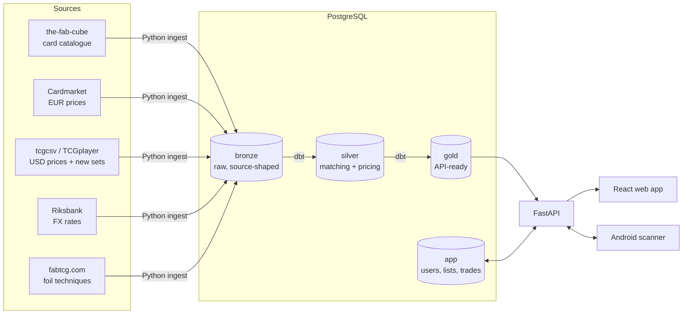

# The FAB Matrix

**Live: [fabmatrix.t4ngo.com](https://fabmatrix.t4ngo.com)**

A price, collection and trading platform for the **Flesh and Blood** trading card game.
It merges four messy public data sources into one priced catalogue of every printing
(≈18,600 printings, **99 % priced**). On top of that it runs a web app for search,
cardlists, player-to-player trading and selling to a store, plus a native Android card
scanner.

The data engineering is the core of the project. Card games print the same card many
times over (set × edition × foil treatment × alt-art). The European (Cardmarket) and
American (TCGplayer) markets name and split those printings differently, and neither one
shares an ID with the card catalogue. Most of the code is about matching them up reliably.



## Features

**Data pipeline**
- Medallion architecture (bronze → silver → gold) in PostgreSQL, transformed with **dbt**
  and covered by 13 data tests (identity fields, accepted values, no negative prices, no
  malformed set or collector IDs).
- **Five-tier price matching.** The TCGplayer product price is the *anchor* for each
  printing. The Cardmarket product is chosen as the one whose EUR price (converted to SEK)
  is closest to that anchor, among every product that shares the card's bare name. A
  sanity guard rejects matches that are ≥20× off, so tokens can't pick up a hero's price.
  Weaker tiers (expansion + foil heuristic, name aggregation, a manual crosswalk) fill the
  gaps, and every row carries its `price_source` and `price_confidence`.
- Sets the catalogue hasn't caught up with yet are backfilled from TCGplayer data, with
  name normalisation (collector numbers, pitch colour and alt-art tags stripped into
  separate fields).
- A QA endpoint (`/admin/price-discrepancies`) compares EUR and USD in SEK and flags
  divergent matches. During development it took bad matches from ~400 down to ~80, and
  the ~80 left are genuine EU/US market gaps.

**Web app** (React + TypeScript)
- Search and filter every printing, with EUR/USD/SEK prices and a card detail view.
- Passwordless email sign-in (magic links via Resend) and named cardlists.
- **Trading post:** public trade lists and per-seller carts. Offers support counter-offers
  and turn-taking, and cards are reserved with row locks so the same copy can't be
  promised twice. Includes direct messages and email notifications.
- **Sell to the store:** a configurable buylist (rates by condition and language, plus
  block/percentage rules that can be capped by value). It gives non-binding quotes,
  re-prices everything on the server, and lets the store counter line by line. Offers
  print to A4 or PDF.
- **Paste-a-list import:** turns a pasted text collection into exact printings. It never
  guesses when look-alike printings differ in price; the user picks from artwork and price.

**Android scanner** (Kotlin, CameraX)
- Captures the card, waits until the footer text is sharp enough, and sends crops to the
  API. Recognition reads the collector code printed in the card's footer and snaps it to
  the nearest real card code, correcting common OCR mix-ups (`0`/`O`, `5`/`S`). Partial
  codes are refused rather than guessed.
- Pairs with the web app through a short code, and scanned cards appear on the web page
  live.

## Tech stack

| Layer | Tools |
|---|---|
| Ingest | Python 3, `requests`, `psycopg2` |
| Storage / transform | PostgreSQL 16 (Docker), dbt-postgres |
| API | FastAPI, Uvicorn, pooled psycopg2 connections, GZip |
| Frontend | React 18, TypeScript, Vite, Tailwind CSS, shadcn/ui, TanStack Query |
| Scanner | Kotlin, CameraX, OkHttp; Tesseract OCR on the server |
| Hosting | Cloudflare named tunnel, systemd user services, Resend email |

## Repository layout

```
ingest_bronze.py          the-fab-cube catalogue, Cardmarket, Riksbank, manual crosswalk → bronze
ingest_tcgcsv.py          TCGplayer USD prices + cards from sets missing in the catalogue
load_collectors_centre.py foil technique per printing (from data/collectors_centre_scrape.md)
setup_db.py               idempotent schema for every bronze/app table (single source of truth)
fab_dbt/                  dbt project: silver_cards (all matching logic) → gold_cards
api.py                    FastAPI wiring; endpoints live in fab_api/routers/
fab_api/                  routers (cards, trade, buylist, auth, …), list parser, scan engine
start_fab.py              runs the API + Cloudflare tunnel
run_pipeline.sh           daily ingest → dbt → serve launcher
backup_app.py             dumps the app.* schema (users, lists, trades)
deploy/                   systemd units (API service, nightly backup timer)
data/                     small hand-maintained inputs (manual crosswalk, scraped foil data)
docs/DEVLOG.md            development log: decisions, dead ends, and why
fab-scanner-android/      Android CameraX scanner app
retro-data-display/       web frontend (separate repo: GHT4ngo/retro-data-display)
```

## Running it locally

Requirements: Python 3.11+, Docker, Node 20+.

```bash
# 1. Config
cp .env.example .env                     # set PG_PASSWORD at minimum

# 2. Python
python3 -m venv .venv
.venv/bin/pip install -r requirements.txt
# optional, for the scanner endpoints: .venv/bin/pip install -r requirements-ocr.txt

# 3. Database + data (the ingest downloads ~100 MB of source data)
docker compose up -d db
.venv/bin/python setup_db.py
.venv/bin/python ingest_bronze.py
.venv/bin/python ingest_tcgcsv.py
( set -a; . ./.env; set +a; cd fab_dbt && ../.venv/bin/dbt run --profiles-dir . && ../.venv/bin/dbt test --profiles-dir . )

# 4. Frontend (the API serves the built app at /)
git clone https://github.com/GHT4ngo/retro-data-display.git
( cd retro-data-display && npm install --legacy-peer-deps && npm run build )

# 5. Serve
.venv/bin/uvicorn api:app --port 8001     # → http://localhost:8001
```

Without `RESEND_API_KEY` sign-in runs in dev mode: the magic link comes back in the API
response instead of by email.

`./run_pipeline.sh` wraps steps 3–5 for daily use (`--help` lists its modes). In
production the API runs as a systemd user service (`deploy/fab-api.service`) behind a
Cloudflare named tunnel.

The Android app builds with `./gradlew :app:assembleDebug` from `fab-scanner-android/`
(see its README).

## Notes

- `CLAUDE.md` holds the detailed working notes: matching rules, data quirks and
  operational gotchas. `docs/DEVLOG.md` records how each part got that way, including
  the approaches that didn't work.
- Flesh and Blood™ is a trademark of Legend Story Studios. This project is unofficial
  and not affiliated with them.
